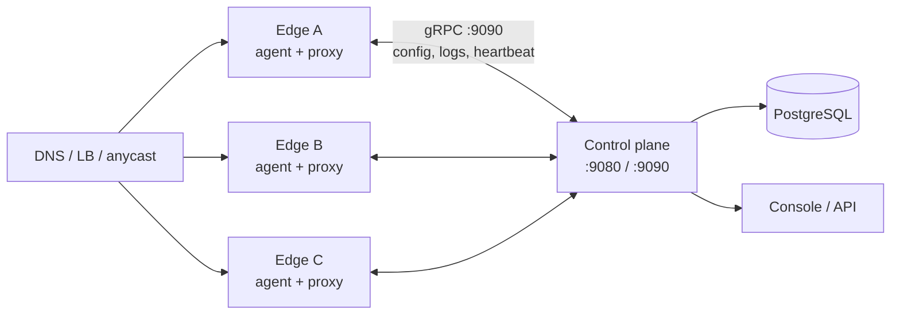
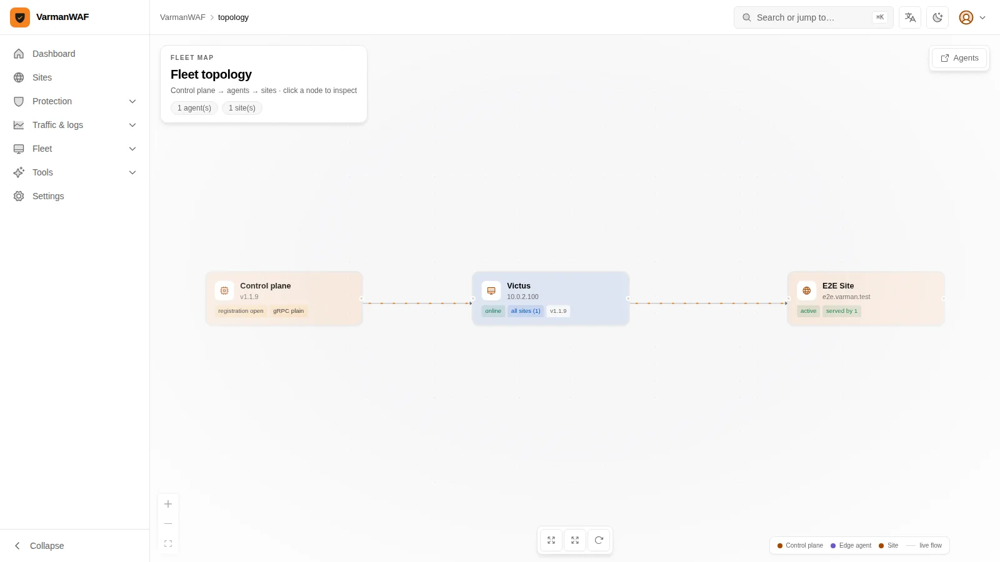
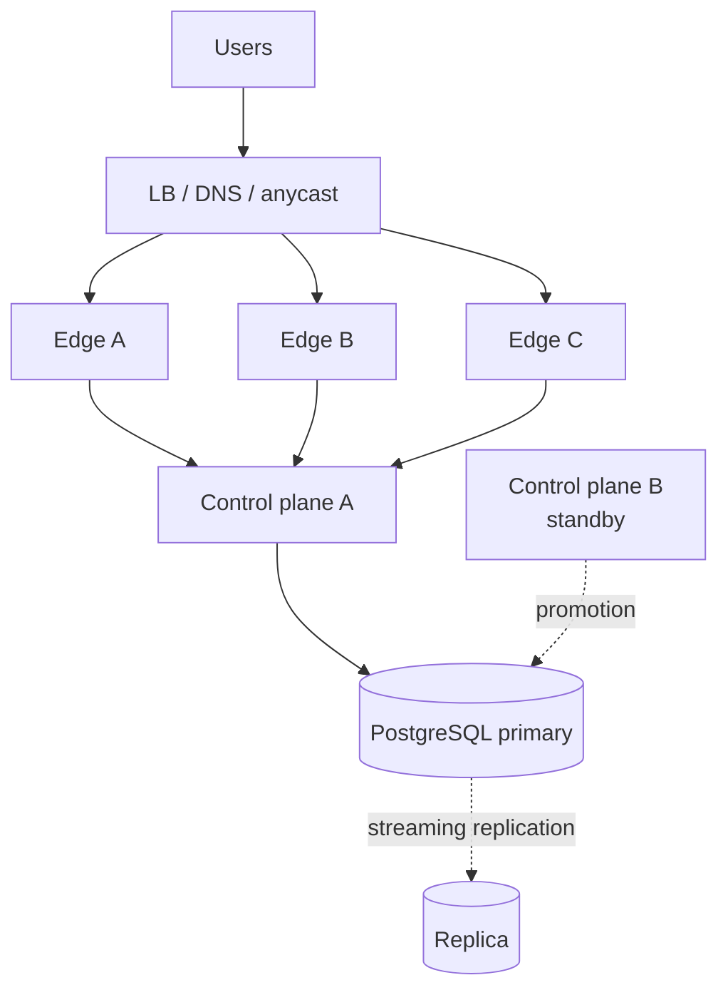

# Choose your deployment path

The control plane compiles configuration; the edge agent serves traffic from
its last-good bundle. The control plane is **never in the request path**, which
is why the split shapes stay up during control-plane maintenance.

## The comparison

| | All-in-one | Control plane + edges | HA fleet |
|---|---|---|---|
| **Processes** | One `varman all-in-one` | `varman server` + N × `varman agent` | 2 control planes + N edges + PostgreSQL HA |
| **Best for** | Labs, a single internal app, a first evaluation | The standard production shape | Customer-facing, multi-site, compliance |
| **Traffic survives control-plane restart** | No (same process) | Yes, from the last-good bundle | Yes |
| **Traffic survives a host loss** | No | Yes, if another edge is in the pool | Yes |
| **Config writes survive a control-plane host loss** | No | No (traffic continues) | Yes, after promotion |
| **Operational cost** | Lowest | Medium | Highest |
| **Prerequisites** | Linux + PostgreSQL | Linux + PostgreSQL + 2 hosts + L4/L7 LB or DNS | The split shape + replicated PostgreSQL + standby control plane |

If you are unsure: start with the split shape and two edge nodes. It is the
smallest topology whose traffic does not depend on the control plane.

## Path A — All-in-one

One container, one process, one PostgreSQL. Good for a first site or a lab.
The failure domain is the host.

```bash
export JWT_SECRET=$(openssl rand -hex 32)
export ADMIN_PASSWORD=$(openssl rand -hex 16)
export POSTGRES_PASSWORD=$(openssl rand -hex 16)

docker compose up -d
curl -sk https://localhost:9080/healthz
```

Dashboard: `https://localhost:9080` (self-signed until you install a
certificate). Default login: `admin@varman.local` with the password you set.
**Change it immediately.**

Deep reference: [Deployment guide](../deployment.md) and
[Quick start](../quick-start.md).

## Path B — Control plane + edge agents

This is the standard production shape. The control plane owns state and the
console; each edge node owns traffic for the sites it serves.



1. Install PostgreSQL and the control plane on the first host.
2. Issue an agent API key in **Settings → API keys** (or pre-register the node
   in **Agents** if registration is closed).
3. Install the agent on each edge host with that key.
4. Bind each agent to a site, or leave it unbound for every site owned by the
   key's owner.
5. Put the edges behind DNS round-robin, a load balancer, or anycast.
6. Verify each node appears in **Agents** with a fresh heartbeat.

```bash
# Control plane
varman server --db-url "postgres://..." \
  --admin-addr 0.0.0.0:9080 --grpc-addr 0.0.0.0:9090

# Edge node
varman agent --server-url "http://control-plane:9090" --api-key "..."
```



A node can serve **one site** (bound) or **all sites owned by its API key**
(unbound, the all-in-one case). The fleet graph only ever draws
`control plane → agent → site`; a direct control-plane → site edge would be a
lie.

Deep reference: [Deployment guide](../deployment.md) and
[High availability](../ha.md).

## Path C — HA edge fleet

Add two independent failure domains to Path B:

1. **Two or more edge nodes** behind a load balancer/DNS/anycast. Losing one
   node removes capacity, not correctness.
2. **A control-plane standby** (a second process against the same or a
   promoted database) so console/API writes survive a host loss.
3. **PostgreSQL HA** (managed failover, or streaming replication with a VIP).
   This is the only stateful component.



What HA **does** promise:

- Edge nodes keep serving from their persisted bundle when the control plane
  is unavailable.
- A node loss is a capacity loss; the remaining nodes serve their sites.
- Configuration changes resume when a control plane is reachable and the
  database is writable.

What it **does not** promise:

- Zero-RPO database writes without replication.
- Automatic promotion of a control-plane host without your orchestrator or
  operator.
- A single global configuration lock; PostgreSQL remains the authority.

Deep reference: [High availability & scaling](../ha.md) and
[Sizing & capacity](../sizing.md).

## Common prerequisites

| Requirement | Minimum | Practical |
|---|---|---|
| OS | Linux amd64/arm64, macOS for development | Ubuntu 22.04+/Debian 12+ |
| PostgreSQL | 14+ | 16, managed or replicated for HA |
| RAM | 512 MB | 2 GB+ for the control plane; size edges from measured traffic |
| Disk | 1 GB | 10 GB+ for logs/cache; separate the database volume |
| Ports | 80, 443, 9080, 9090 | 5432 internal only |

```bash
sudo ufw allow 80/tcp
sudo ufw allow 443/tcp
sudo ufw allow 9080/tcp
sudo ufw allow 9090/tcp   # only if agents connect remotely
```

## Secrets you must set

| Secret | Why |
|---|---|
| `JWT_SECRET` | Signs console/API sessions; at least 16 chars, generate 32 bytes |
| `ADMIN_PASSWORD` | Initial admin password; change after first login |
| `POSTGRES_PASSWORD` | Database credential |
| Agent API keys | One per edge/integration; scoped, rotatable |

Never keep the seeded `varman123` on a reachable host. Never commit a
production `.env`.

## First-run verification

```bash
curl -sk https://localhost:9080/healthz
curl -sk https://localhost:9080/api/v1/version

# Through the edge, with the site's Host header:
curl -sk https://localhost/ -H 'Host: app.example.com' -I
```

A healthy control plane with an unreachable edge is not a deployment. Verify
the edge response has `server: varmanwaf` and a request ID.

## Upgrade and rollback

**Split/HA order:** control plane first, verify, then each agent one at a time.

```bash
docker compose pull varman
docker compose up -d --force-recreate varman
curl -sk https://localhost:9080/api/v1/version
```

- Migrations run on control-plane startup.
- Keep the previous image tag on hand.
- Roll back the image; restore the database only if the schema changed and you
  have a matching backup.
- The release notes record the image digest and verification for every round:
  [Releases](../releases/index.html).

## Which role owns what

| Decision | Role |
|---|---|
| Site mode, origin, routes, cache, certificate for one site | [Site owner](./roles/site-user.md) |
| Users, policies, CRS, IP groups, alerts, reports | [Administrator](./roles/administrator.md) |
| Hosts, PostgreSQL, edges, HA, backup, upgrade | [System administrator](./roles/system-administrator.md) |
| Code, API, engine, console, release | [Developer](./roles/developer.md) |

## Related

- [Quick start](../quick-start.md) — the shortest path to one protected site.
- [Deployment guide](../deployment.md) — every config key, firewall, backup.
- [High availability](../ha.md) — node sync, DNS, failure semantics.
- [Sizing](../sizing.md) — measured capacity and resource use.
- [For system administrators](./roles/system-administrator.md) — the runbook.
