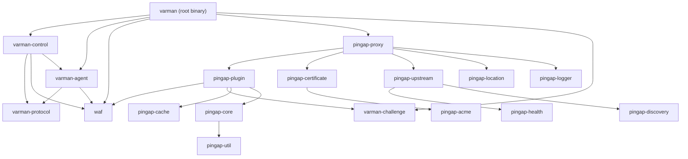

# Workspace Modules

VarmanWAF is one Cargo workspace with two layers: the **Varman** crates (the
WAF platform) and the **`pingap-*` foundation** (the proxy engine the fork is
built on). This page is the map; each crate's own README goes deeper.

## Varman crates

| Crate | What it owns |
| --- | --- |
| `varman-control` | Control plane: REST API (48 modules), gRPC server, SeaORM/PostgreSQL store + migrations, config-history versioning, the embedded console, self-protection |
| `varman-agent` | Edge agent: registration, heartbeats, bundle cache with disk persistence, blocked-IP ledger, log/metric/certificate shipping |
| `varman-waf` | The security engine: canonical model, signature lane, managed rules, custom-rule evaluator, SecLang/CRS, API-schema layer, exclusions, scoring, corpora |
| `varman-protocol` | gRPC protocol definitions (single source: `proto/control_plane.proto`) |
| `varman-challenge` | Challenge engine: JS shield, PoW, clearance cookies, fingerprints |
| `varman-pprof` | Built-in profiling (CPU profiles, flame graphs, memory snapshots) |
| `varman` (root) | The binary: `all-in-one` / `server` / `agent` assembly, CLI, admin plugin |

## Proxy foundation (`pingap-*`)

| Crate | What it owns |
| --- | --- |
| `pingap-proxy` | The proxy engine: lifecycle, routing, server configuration |
| `pingap-core` | `Ctx`, `HttpResponse`, the `Plugin` trait, background services |
| `pingap-config` | Configuration model, storage backends, TOML/HCL/KDL |
| `pingap-plugin` | Built-in plugins, including the Varman WAF plugin (`waf.rs`), challenge, error pages, rewrite, cache, compression |
| `pingap-upstream` | Load balancing, circuit breaking, upstream connection options |
| `pingap-location` | Host/path matching, rewriting, per-location limits |
| `pingap-certificate` | SNI-based dynamic TLS certificate store |
| `pingap-acme` | Let's Encrypt HTTP-01 / DNS-01 automation |
| `pingap-cache` | Memory and file cache backends |
| `pingap-discovery` | Static / DNS / Docker / transparent backend discovery |
| `pingap-health` | TCP, HTTP(S) and gRPC health checks |
| `pingap-logger` | Access logs, writers, rotation, compression |
| `pingap-performance` | Prometheus metrics and process introspection |
| `pingap-otel` / `pingap-sentry` / `pingap-pyroscope` | Tracing, error reporting, continuous profiling |
| `pingap-webhook` | Operational notifications (WeCom / DingTalk / HTTP) |
| `pingap-imageoptim` | PNG/JPEG → WebP/AVIF conversion |
| `pingap-util` | Crypto, IP rules, PEM/base64, path and formatting helpers |

## Dependency shape

Request flow, invariants and failure semantics live in
[`architecture.md`](./architecture.md); the engine itself in
[`security-engine.md`](./security-engine.md).
