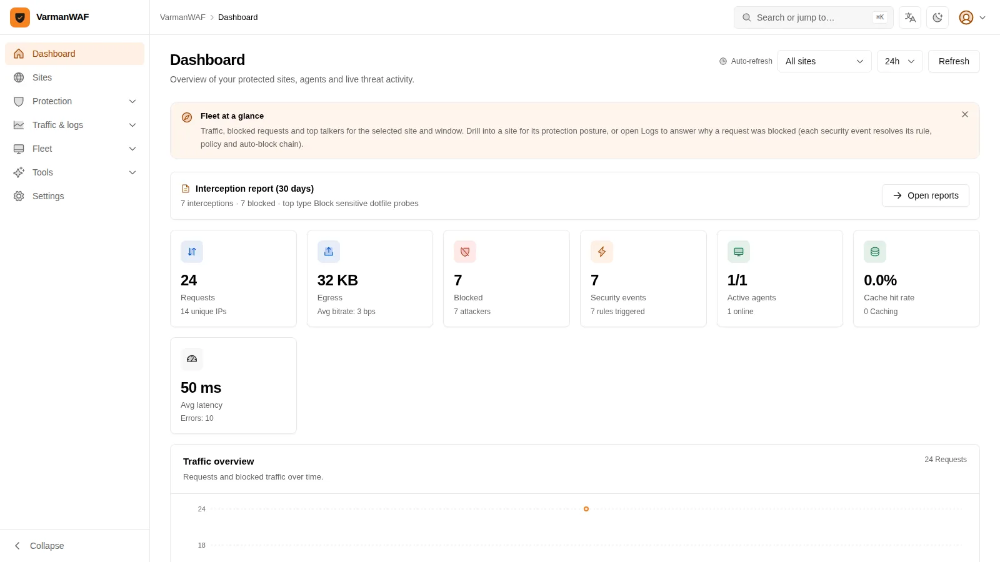
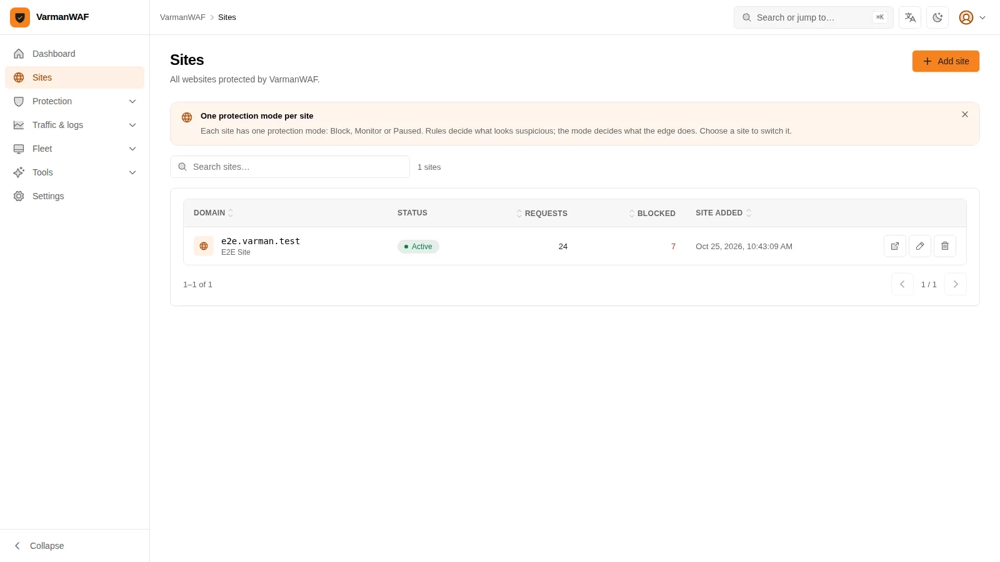
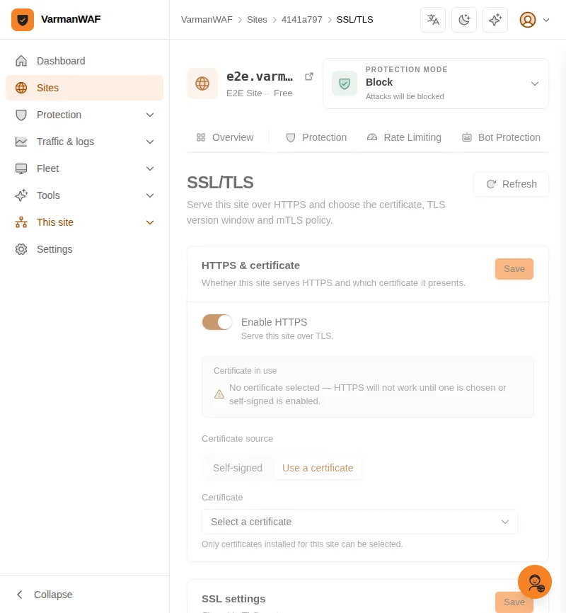
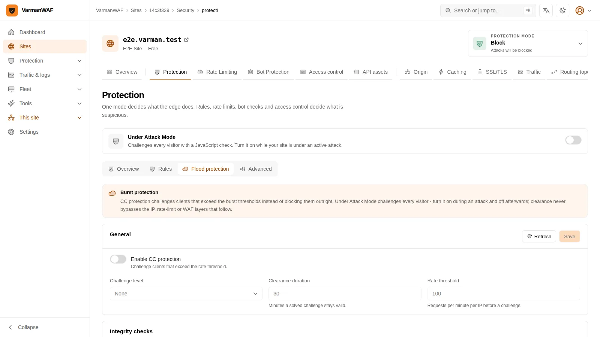
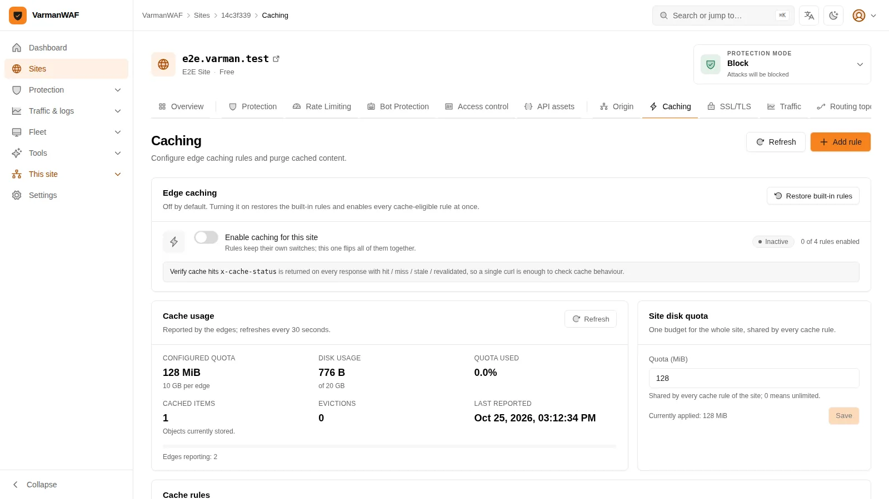
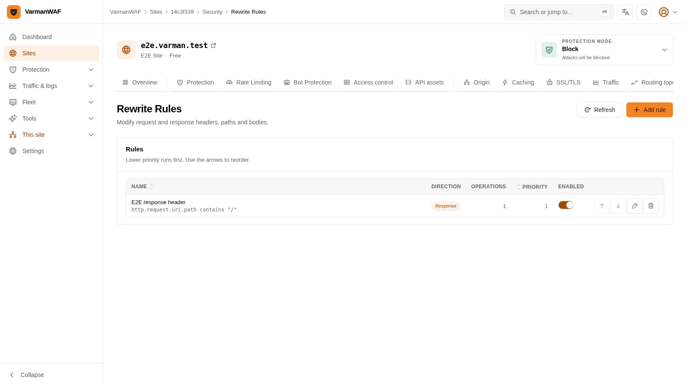
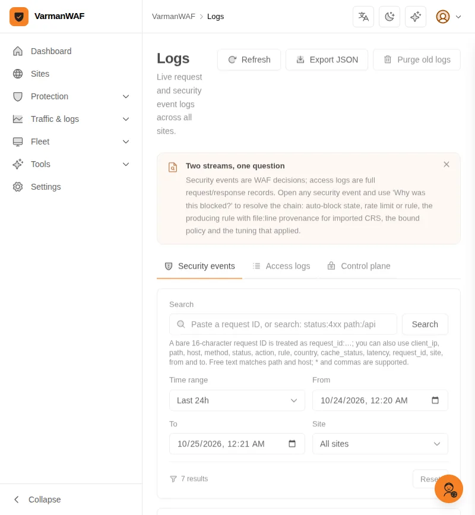
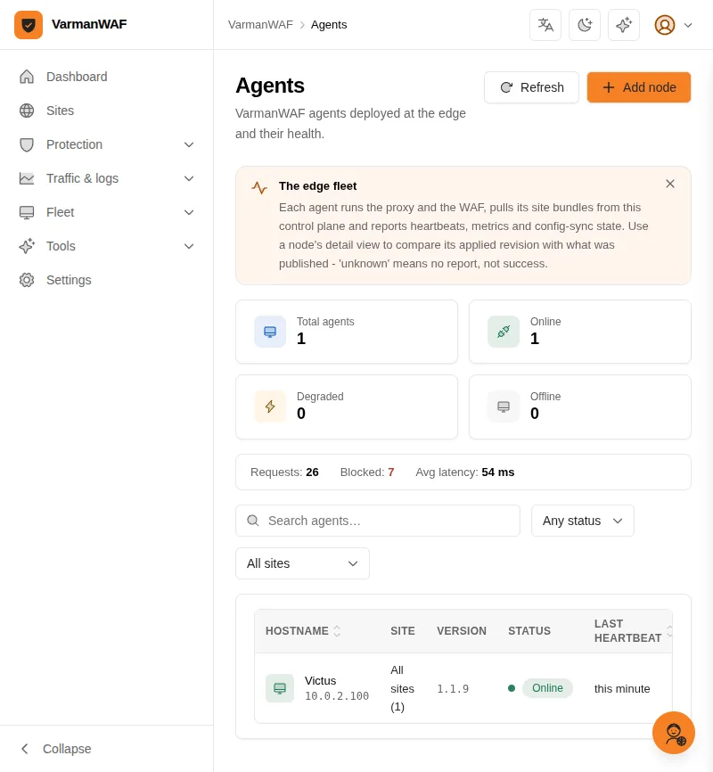
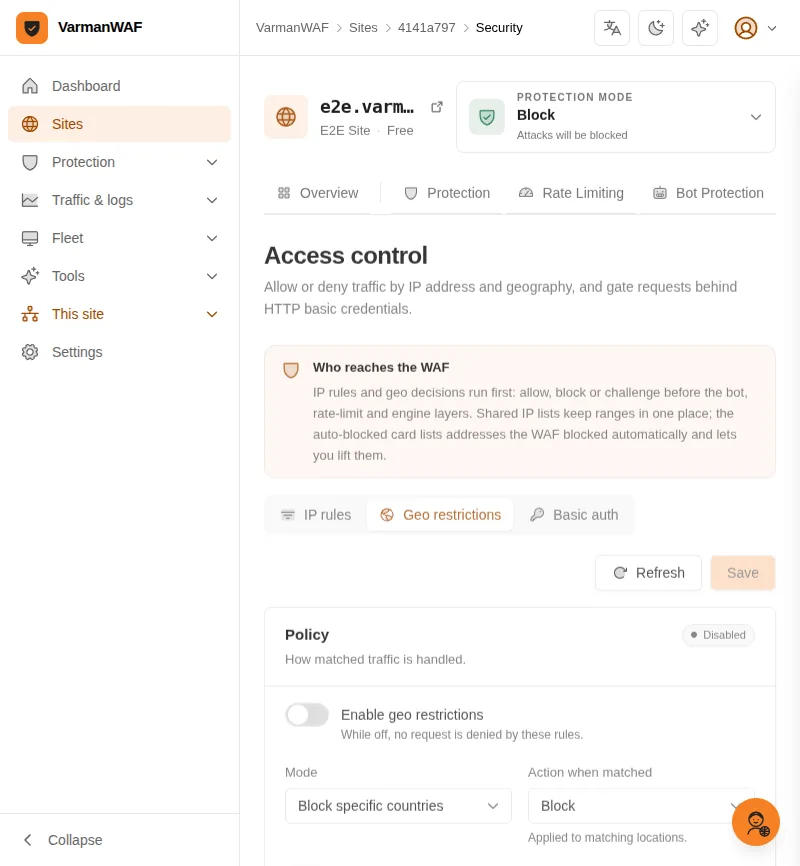

# VarmanWAF User Guide

> **Where this fits**: the current per-surface inventory is
> [`features.md`](./features.md) and the deepest walkthrough (with screenshots
> of every feature) is the Khmer guide
> ([`user-guide-km/index.html`](./user-guide-km/index.html)). This English
> guide covers the same core flows end to end.

## Getting Started

### First Login

1. Open the dashboard at `https://your-server:9080` (self-signed certificate
   until you upload a real one under Settings → Control plane HTTPS)
2. Log in with the seeded credentials:
   - Email: `admin@varman.local`
   - Password: `varman123`
3. **Immediately change your password**: Profile → Change Password

### Dashboard Overview



The dashboard provides:
- **Analytics**: Request trends, per-site traffic over time, top rules triggered, status codes
- **Sites**: Manage protected websites
- **Agents**: Monitor connected data-plane agents
- **Logs**: Security events and access logs
- **Settings**: Elasticsearch, API keys, global preferences

### Keyboard and accessibility

- Press **Tab** from the top of a page to reveal **Skip to content**; Enter
  moves focus to the main content.
- Table headers that can be sorted are buttons: Tab to one, then use Enter or
  Space. Screen readers announce the current sort through `aria-sort`.
- Dialogs take focus when they open, keep Tab inside, and return focus to the
  control that opened them. Escape closes the dialog.
- The console respects the operating system's reduced-motion setting: entrance
  animation and movement are removed, while color and border feedback remains.
- Route pages load on demand. A short loading state appears inside the shell
  on first visit; subsequent visits use the cached chunk.

## Adding a Website

### Step 1: Create a Site



Navigate to **Sites → Add Site**:
- **Name**: Human-readable label (e.g., "Production API")
- **Domain**: The hostname to protect (e.g., `api.example.com`)
- **Plan**: `free`, `pro`, or `enterprise` (affects feature limits)

### Step 2: Configure Upstreams

Each site needs at least one origin server:

```
Sites → [your site] → Origin → Add node
```

When you open a site, the **Overview** tab answers "what does this site serve
and what is enforced on it": 24-hour requests / blocked / security events,
the protection mode and paranoia level in force, the serving certificate,
origin health, and the latest findings. Each card links to the tab that owns
the setting. The **Origin** tab is where upstreams are edited - every site
starts with a `default` origin pool, and the first node you add goes into it.
See [Origin Pools & Routes](#origin-pools--routes) for pools, load balancing
and path-based dispatch.

| Field | Description |
|-------|-------------|
| Node name | Label for this origin (e.g., "origin-1") |
| Origin address | Origin `host:port` (e.g., `10.0.0.1:8080`) |
| Weight | 1–10000; round robin splits traffic by weight (default: 1) |
| Pool | Origin pool the node belongs to |

### Step 3: DNS Setup

Point your domain's DNS to the VarmanWAF server:
- **A record**: `api.example.com → YOUR_VARMAN_IP`
- **CNAME**: If behind a load balancer

### Step 4: SSL Certificate



See [SSL Certificate Management](#ssl-certificate-management) below.

## Origin Pools & Routes

Open **Sites → [your site] → Origin** to manage origin pools, load balancing and route dispatch.

### Origin Pools

An origin pool is a set of origin nodes sharing one load-balancing algorithm and origin protocol.

| Field | Description |
|-------|-------------|
| Pool name | Label for the pool (e.g., "primary") |
| Load balancing | `Round robin` or a hash algorithm (see below) |
| SNI hostname | Non-empty enables **HTTPS to origin**; must be a bare hostname covered by the origin certificate (`$host` is not supported) |
| Verify origin certificate | Turning this off skips certificate validation (not recommended) |

An empty SNI means the WAF talks plain HTTP to `private_ip:port`. A non-empty
SNI switches that pool to HTTPS; with a self-signed app certificate you also
need **Verify origin certificate = off**, and the WAF→origin failure appears as
a **502**, not a 525. The two TLS legs, the log signatures and the security
trade-off are covered in
[TLS troubleshooting §10](./tls-troubleshooting.md#10-origin-tls-http-backends-and-self-signed-https-backends).

### Origin health checks

Each pool can probe its nodes with an HTTP health check. A node that fails the
probe is taken out of rotation by the edge until it recovers.

| Field | Description |
|-------|-------------|
| Active health check | Turns the periodic probe on for this pool |
| Probe path | Path the edge requests, e.g. `/health`; must start with `/` |
| Interval | Seconds between probes (5–3600; the edge aligns to 10-second steps) |
| Timeout | Connect/read timeout in milliseconds (100–30000) |
| Failures to unhealthy | Consecutive failed probes before a node is removed (1–10) |
| Successes to healthy | Consecutive successful probes before it returns (1–10) |

The pool card shows the active-check path and interval. Every node has a
**Health** column: **Reachable**, **Reachable · 5xx** or **Unreachable**.

Use **Test now** on a pool to probe every node immediately and see the HTTP
status, latency and any connection/TLS error. In all-in-one mode the probe runs
from the WAF host, so it answers “can the WAF reach this origin?”. In a split
deployment it runs from the control-plane host; the edge’s own network path can
still differ.

An origin that points back at the WAF is refused. `localhost`, `127.0.0.1`,
`::1` or `0.0.0.0` on ports **80, 443, 9080 or 9090** would proxy every request
back into the same listener; use the application's private `IP:port` instead.
A local app on another port (for example `127.0.0.1:3001`) is still allowed.

Load-balancing algorithms:

| Algorithm | Spec | Behavior |
|-----------|------|----------|
| Round robin | `round_robin` | Spreads requests by node weight |
| Least connections | `least_connections` | Picks the node with the fewest in-flight requests |
| Random | `random` | Picks a node at random (weight-aware) |
| IP hash | `hash:ip` | Pins the same client IP to one node |
| URL hash | `hash:url` | Pins by request URL |
| Path hash | `hash:path` | Pins by request path |
| Header hash | `hash:header:<name>` | Pins by a request header value |
| Cookie hash | `hash:cookie:<name>` | Pins by a cookie value |
| Query hash | `hash:query:<name>` | Pins by a query-string parameter |

The site's default pool (marked **Default**) cannot be deleted, and a pool can only be deleted once no origin nodes and no routes reference it.

### Routes

Routes dispatch requests to different pools by path; unmatched traffic goes to the default pool.

| Field | Description |
|-------|-------------|
| Rule name | Label for the route (e.g., "api-to-dedicated-pool") |
| Match | `Prefix`, `Exact`, or `Regex` |
| Path | Starts with `/` (e.g., `/api`), or a regular expression (e.g., `^/static/.*`) |
| Priority weight | 1–60000; empty uses the auto weight (exact 1024 / prefix 512 / regex 256) |
| Target pool | Pool that receives matching traffic |
| Enabled | Toggle a route without deleting it |

A prefix route on `/` is rejected: it would conflict with the default-pool fallback.

## WAF Configuration

### Protection mode, rules, and advanced settings

The console keeps one enforcement decision in one place. Three surfaces remain,
but only one of them is a mode:

| Surface | What it decides | Where |
|---------|-----------------|-------|
| **Protection mode** | *What the edge does with matching traffic*: Block, Monitor or Paused. This is the gate the engine reads. | The site header, on every site tab |
| **Rules** | *What looks like an attack*: built-in managed rules, custom rules, SecLang/CRS rules and API schema checks. Every match produces a finding with a rule id and an anomaly score. A rule's own **Rule mode** only overrides that one rule. | Protection → Rules |
| **Advanced** | Paranoia level, advanced mode, monitor-only categories, exclusions, and an optional shared policy. Most sites never need this page. | Protection → Advanced |

The order is **detection → enforcement → reuse**. Changing a rule to Block
does not override the site's Protection mode; the site mode always wins. This
is why the rules page no longer offers a bulk mode switch.

### Protection modes

| Mode | Behavior |
|------|----------|
| **Block** | Findings that pass their gates are answered by the WAF (403 by default) and recorded. |
| **Monitor** | Every finding is recorded with its rule, score and request path. Nothing is blocked; traffic is proxied to the origin normally. |
| **Paused** | The site goes offline: the edge answers every request with a maintenance page. Use it for planned maintenance, not as a substitute for Monitor. |

Set via the **Protection mode** control at the top of any site page. Choosing
Block or Monitor resumes a paused site. The control writes the site status and
the enforcement mode, and the change syncs to the edge.

A site that follows a shared policy has its mode controlled by that policy.
The dialog says so and links to **Protection → Advanced**, where the policy is
managed or paused; it does not pretend a local change would take effect.

### "I sent an attack and nothing was blocked"

Check these in order:

1. **Protection mode.** The control at the top of the site shows the mode in
   force. In **Monitor** nothing blocks by design - this is the most common
   cause. In **Paused**, requests never reach the origin.
2. **The finding exists.** `Logs → Security` (or the site's **Overview** tab)
   shows the event with its action, rule id and anomaly score. No row at all
   means the request never reached the edge: check DNS, the port, and the mode.
3. **The score crossed a threshold.** A union-select probe can be detected by
   `sig.sqli.union_bare` at score 55 while the built-in SQLi gate
   (VARMAN-1002) starts at 60. A custom rule such as
   `cf.waf.score.sqli ge 40` closes that gap.
4. **The rule is enabled and its paranoia level is not above the site's.** A
   Strict-only rule does not run on a Normal/PL2 site. A rule whose own Rule
   mode is Monitor will stay monitor-only even when the site is Block.
5. **Re-test.** With mode **Block**, repeat the request: expect a 403 and a
   new event with `action: block`. The event's *why* panel names the rule,
   score, policy and any exclusion that applied.

### Rule Groups

Rules are organized into groups that execute in order:

| Phase | Description |
|-------|-------------|
| `request` | Evaluated on incoming requests |
| `response` | Evaluated on upstream responses |
| `custom` | User-defined rule groups |

### WAF Rules

Each rule defines a condition and an action:

**Conditions** (match any):
- Request URI path (regex or prefix)
- HTTP method
- Request headers
- Query parameters
- Request body content
- IP address / CIDR range
- User-Agent string
- Country (GeoIP)

**Actions**:
- `allow` — Skip remaining rules, permit request
- `block` — Return 403 Forbidden
- `challenge` — Show CAPTCHA/JS challenge
- `rate_limit` — Apply rate limiting
- `log` — Log only, do not block
- `redirect` — Redirect to a URL

### Managed Rulesets

VarmanWAF includes built-in protection against:
- SQL Injection (SQLi)
- Cross-Site Scripting (XSS)
- Remote Code Execution (RCE)
- Path Traversal
- Command Injection
- Protocol violations

Enable/disable individual rules within managed groups.

### Rule Grading

```
Sites → [site] → Protection → Advanced
```

Besides per-rule toggles, the whole detection posture of a site can be graded:

| Control | Behavior |
|---------|----------|
| **Advanced mode** | Enables the strict managed rule set plus deep request-body inspection. Higher interception rate at a proportional performance cost. |
| **Attack categories** (9) | `sqli`, `xss`, `rce`, `lfi`, `ssrf`, `deser`, `crlf`, `xxe`, `ssti` — switch a family off to downgrade its matches to monitoring: detection and logging stay fully active, but nothing is blocked. |
| **Backend stacks** (4) | `java`, `php`, `python`, `node` — same downgrade semantics for stack-specific detections. Language-agnostic detections are never downgraded by a stack switch. |

A site without explicit grading settings behaves exactly like the default posture: every detection blocks.

### Under Attack Mode

```
Sites → [site] → Protection (top banner)
```

A site-wide emergency switch: every visitor is challenged with a JavaScript check, and CC protection is switched on automatically. Enable it only while the site is under an active flood attack and disable it once the attack subsides.

## Rate Limiting

Configure per-site rate limits:

```
Sites → [site] → Rate Limiting → Add Rule
```

| Field | Description |
|-------|-------------|
| Name | Rule label |
| Threshold | Max requests allowed in the period |
| Period (seconds) | Time window for counting (1–86400) |
| Action | `block`, `log`, `challenge`, `js_challenge`, or `allow` |
| Characteristics | How to group traffic: `ip`, `ip_nat`, `host`, `path`, `asn`, `country`, plus parameterized forms `header:<name>`, `cookie:<name>`, `query:<name>` |
| Filter expression | Optional match condition (empty = all requests) |
| Mitigation timeout | How long the action applies once triggered (0–86400 seconds) |

Example: Limit to 100 requests per 60 seconds per IP on `/api/*`.

Requests missing the header, cookie or query parameter bucket together, so they still count against the limit. Header names match case-insensitively; cookie and query names are case-sensitive. The `ja3` characteristic is reserved for future use and is not yet accepted by the API.

## Flood protection & challenges



### Challenge Settings

```
Sites → [site] → Protection → Flood protection
```

| Setting | Options |
|---------|---------|
| Mode | `off`, `passive`, `active` |
| Type | `js_challenge`, `captcha`, `managed` |
| Expiry | How long a passed challenge remains valid |

- **Passive**: Challenge only when suspicious behavior is detected
- **Active**: Challenge all requests matching configured criteria

## Cache Configuration

### Cache Rules



```
Sites → [site] → Cache Rules
```

| Field | Description |
|-------|-------------|
| Name | Rule label |
| Path pattern | URI pattern to cache (e.g., `/static/*`) |
| Edge TTL | How long to cache at the edge (seconds) |
| Browser TTL | `Cache-Control: max-age` sent to clients |
| Status | `enabled` or `disabled` |

### Cache Purging

Purge cached content immediately:

```
Cache → Purge
```

Options:
- Purge all cache for a site
- Purge by URL pattern
- Purge by cache tag

### Disk Quotas

Monitor cache disk usage:

```
Cache → Status
```

Shows per-site cache size and hit rates.

## SSL Certificate Management

### Automatic (ACME / Let's Encrypt)

```
Sites → [site] → Certificates → Add → Let's Encrypt
```

**Challenge Types:**
- **HTTP-01**: Requires port 80 reachable. Best for most setups.
- **DNS-01**: Supports wildcard certificates. Providers:
  - Cloudflare
  - Route 53
  - DigitalOcean
  - Aliyun (Alibaba Cloud)
  - DNSPod (Tencent Cloud)
  - CloudXNS
  - Manual

Certificates auto-renew 30 days before expiry.

### Manual Upload

```
Sites → [site] → Certificates → Add → Upload
```

Provide:
- Certificate (PEM format, including chain)
- Private key (PEM format)
- Domain names covered

### SSL Settings

```
Sites → [site] → SSL Settings
```

- Minimum TLS version (1.2 or 1.3)
- Force HTTPS redirect
- HSTS configuration
- OCSP stapling

### Certificate Status and Events

Agents report each site's certificate status in every heartbeat, shown on the SSL/TLS page:

- **Valid**
- **Expiring soon** — the certificate lapses within 48 hours
- **Expired**

The SSL/TLS page also keeps an event log per certificate — created, renewal requested, renewed, failed, deleted, plus raw ACME output — so issuance attempts can be followed from the console.

### Live issuance log

Applying for an ACME certificate or clicking **Renew now** opens a live log
window. It tails the certificate's events every 1.5 seconds and refreshes the
certificate status, so the order can be watched without leaving the page:

- **Order queued** — `renewal_requested` appears immediately.
- **Order running** — raw `acme_raw` lines show authorization creation, the
  challenge token being served, validation and “renew certificate success”.
- **Finished or failed** — the certificate badge moves to **Active** or
  **Failed**; `issuance_failed` explains a stale order.

The window can be paused, copied or downloaded, and follows the newest line
unless you scroll up. Every certificate row also has a terminal button to open
its log at any time. A queued renewal is picked up at the next ACME window
(about 10 minutes), so an empty log at first is normal — the window says so.
The event log is retained after the dialog is closed.

If the CDN returns **525/526**, the origin serves no certificate, or the list says **Unknown issuer**, follow [TLS troubleshooting](./tls-troubleshooting.md). It explains which check to run first and when the label is only cosmetic.

## TCP Port Forwarding

**Sites → [site] → Port forwarding** exposes a private TCP service (SSH, RDP,
a database, an internal admin port) on a published edge port. The WAF/agent
listens on the chosen port and copies bytes to the private target; the target
itself is never published.

| Field | Description |
|-------|-------------|
| Name | Label for the forward |
| Listen port | Public edge port, **10000–10099** |
| Target host | Private IP or hostname (for example `10.1.18.200`) |
| Target port | Port the private service listens on (for example `22`) |
| Allowed source addresses | One IP or CIDR per line; **at least one is required** |
| Enabled | Open or close the listener |

The agent checks the accepted client address against the allowlist before it
connects to the target. A connection from any other address is dropped and
logged.

Deployment requirements:

- The Docker/host firewall must publish the same range. The shipped compose
  maps `10000-10099:10000-10099`; a custom deployment must do the same.
- Open the range in the host firewall. Do not expose it more widely than the
  allowlist requires.
- This is raw TCP. The target protocol's own encryption (SSH, RDP, TLS) still
  applies; do not send plaintext protocols over the internet.

Exposing SSH/RDP/databases directly is high risk. Prefer a VPN or zero-trust
access layer, and keep the allowed source list as narrow as possible.

## Request/Response Rewriting



### Rewrite Rules

```
Sites → [site] → Rewrite Rules → Add
```

| Field | Description |
|-------|-------------|
| Type | `request` or `response` |
| Match | URL pattern (regex) |
| Replace | Replacement string |
| Headers | Add/remove/modify headers |

Examples:
- Strip `/api/v1` prefix: match `^/api/v1/(.*)` → replace `/$1`
- Add security headers: `X-Frame-Options: DENY`
- Remove `Server` header from responses

## Custom Error Pages

```
Sites → [site] → Error Pages → Add
```

| Field | Description |
|-------|-------------|
| Status code | HTTP status to customize (e.g., 403, 429, 502) |
| Content type | `html`, `json`, or `text` |
| Body | Custom response content |

## Log Management

### Viewing Logs



**Security Events**: `Logs → Security`
- Filtered by site, rule, action, time range
- Shows matched rule, client IP, request details; the **Rule** column names
  the deciding rule and keeps the first match as a secondary line
- Paste a 16-character request id into the search box (or use the global
  search) to jump to the request; open the event to copy the id, switch to
  its access log, or search every event for a matched rule

**Access Logs**: `Logs → Access`
- All proxied requests with timing information
- Filter by status code, path, client IP
- Request headers and a body preview (first 1 KiB) are stored in PostgreSQL, so requests can be inspected from the dashboard without Elasticsearch

### Elasticsearch Integration

For high-volume deployments, ship logs to Elasticsearch:

```
Settings → Elasticsearch
```

| Setting | Description |
|---------|-------------|
| URLs | Comma-separated ES endpoints |
| Index prefix | Prefix for daily indices |
| Username/Password | Basic auth credentials |
| API Key | Alternative to basic auth |
| Max body size | Truncation limit for logged bodies |

Enable the Elasticsearch shipper via environment:
```bash
VARMAN_ES_ENABLED=true
VARMAN_ES_URLS=http://elasticsearch:9200
```

### Log Retention

Purge old logs:
```
Logs → Purge (select age threshold)
```

## Agent Management



### Adding Agents

1. Generate an API key: **Settings → API Keys → Create**
2. Install the agent on the edge server:
   ```bash
   varman agent --server-url http://control-plane:9090 --api-key YOUR_KEY
   ```
3. The agent appears automatically in **Agents**

### Monitoring Agents

The Agents page shows:
- Connection status (online/offline/degraded)
- Last heartbeat time
- System info (hostname, OS, CPU, memory)
- Agent version
- Pending commands

### Agent Commands

Push commands to connected agents:
- **Reload Config**: Force immediate config sync
- **Block IP**: Temporarily block an IP address
- **Unblock IP**: Remove a temporary block
- **Purge Cache**: Clear local cache
- **Restart Agent**: Graceful agent restart

## Access Control

Per-site IP rules and geo restrictions live on one page:

```
Sites → [site] → Access control
```

Switch between the **IP rules** and **Geo restrictions** tabs with `?tab=ip` / `?tab=geo`; links to the former separate IP-rules and geo pages redirect here automatically.

### IP Rules

| Field | Description |
|-------|-------------|
| Rule name | Label for the rule (e.g., "Block scraper subnet") |
| Target | A manual **IP / CIDR** list, or an **IP group reference** whose ranges always follow the group's latest contents |
| IP/CIDR | Address or range (e.g., `192.168.1.0/24`) — manual mode only |
| Action | `block`, `allow`, `challenge`, or `js_challenge` |
| Note | Why this rule exists (audit) |
| Priority | Lower values are matched first |

IP rules are evaluated before the WAF. Bulk import accepts one IP or CIDR per line.

### Geo Restrictions



Block or allow traffic by country and ASN:

- **Mode**: `block_list` (block specific countries) or `allow_list` (allow only specific countries)
- **Countries**: ISO 3166-1 alpha-2 codes (e.g., US, CN, DE)
- **Blocked ASNs**: deny entire autonomous systems (e.g., `AS13335`)
- **Block unknown locations**: deny traffic whose location cannot be determined
- **Action**: how matched traffic is handled

A "Requests by country" chart (last 24 hours) sits next to the policy editor.

### Global IP Groups

**IP Groups** (in the sidebar) manages named collections of IP ranges, either **global** (applied to all sites) or **per-site** (assigned to selected sites). Each group has an action: `block` or `allow`.

Groups can subscribe to an external list instead of (or in addition to) manually entered ranges:

| Field | Description |
|-------|-------------|
| Subscription Source URL | URL of the list to fetch (e.g., `https://example.com/ip-list.txt`) |
| Refresh interval | Manual only, hourly, every 6 hours, daily, or weekly |

A background scheduler refreshes enabled subscriptions when their interval elapses; use **Sync now** to refresh immediately. A failed sync keeps the previous ranges and records the error, which is shown on the group's row as the last sync error.

One group, **Cloudflare**, is seeded on first boot: the official Cloudflare IP ranges from `https://api.cloudflare.com/client/v4/ips`, refreshed daily. It starts disabled — enable it once you know how it fits your traffic.

Site IP rules can reference a group instead of enumerating ranges; see [IP Rules](#ip-rules) above.

## Bot Protection

```
Sites → [site] → Bot Protection
```

| Setting | Description |
|---------|-------------|
| Enable bot protection | Turn classification on or off |
| User-Agent analysis | Inspect the User-Agent header to classify traffic |
| Bot action | `block`, `challenge`, or `log` — applied to traffic classified as a bot (non-browser user agents) |
| Known bots | Whitelist of good crawlers that always pass |

How a request is classified:

1. Verified bots whose User-Agent matches a **known bots** entry pass.
2. Real browsers (known browser user agents) pass.
3. Everything else receives the configured **bot action**.

Known-bot entries are case-insensitive substrings matched against the User-Agent header (e.g., `Googlebot`); the console offers quick-add suggestions for common crawlers.

JavaScript detection, TLS fingerprinting and behavioral analysis appear in the console as *Coming soon* — they are roadmap items, not implemented yet.

## AI Assistant

```
Settings → AI assistant · sidebar assistant icon
```

The console embeds an AI assistant that answers questions about your deployment by calling the same MCP tools external clients use (see below). Configure an OpenAI-compatible provider under **Settings → AI assistant**:

| Setting | Description |
|---------|-------------|
| Enable assistant | Master switch; the AI Assistant page prompts for setup while it is off |
| Base URL | OpenAI-compatible endpoint, e.g. `https://api.openai.com/v1` |
| Model | Model name, e.g. `gpt-4o-mini` |
| API key | Provider credential, stored server-side and shown masked afterwards |
| Temperature | 0–2; lower answers change less between runs |
| Max tool rounds | How many tool-call rounds one answer may take (1–10) |
| System prompt | Prefilled with the built-in default; clear and save to reuse it |
| Allow write tools | Off by default; enables the tools that change state (observation mode, site enable/disable) |

**Test draft** verifies the provider without saving. Once enabled, ask a question on the AI Assistant page and watch tool calls appear inline as the answer streams. Conversations are stored server-side, so history survives reloads, and the assistant is administrator-only.

## MCP Server

```
Settings → MCP server
```

Every deployment hosts an MCP (Model Context Protocol) endpoint at `/mcp` on the console origin, so external AI agents — Claude Code, IDE copilots, scripts — can inspect and operate the firewall. The Settings card shows the live endpoint, the tool inventory (write tools tagged), and copy-paste client snippets.

To connect a client you need an API key (**Settings → API keys**) with the `read` permission; add `write`, whose owner must be an administrator, for the two tools that change state. Then paste the card's JSON into the client, or for Claude Code run:

```bash
claude mcp add --transport http varman https://waf.example.com:9080/mcp \
  --header "Authorization: Bearer pwk_YOUR_KEY"
```

Read-only credentials see only the read tools; administrators with a `write` key may also call `set_observation_mode` and `set_site_status`. The endpoint sits behind the same API protection as the console (access log, IP allowlist, WAF), so it obeys whatever **Settings → API protection** allows.

## Internationalization (i18n)

The dashboard supports multiple languages:
- English (default)
- 中文 (Chinese)
- 日本語 (Japanese)

Language is auto-detected from the browser. Override via the language selector in the dashboard header.
